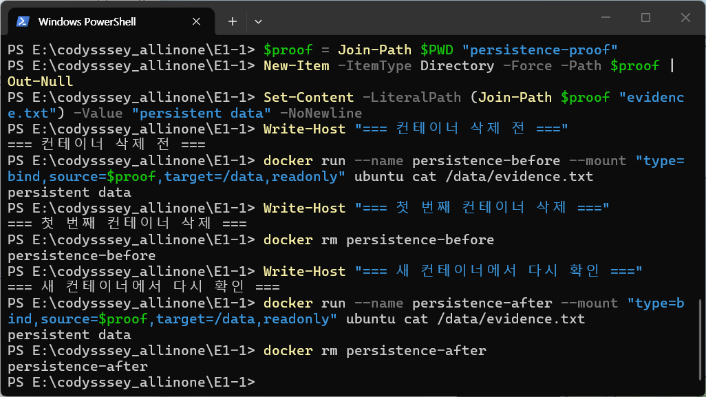
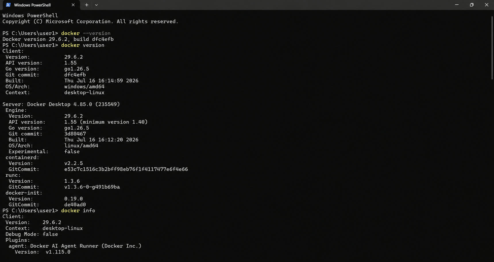
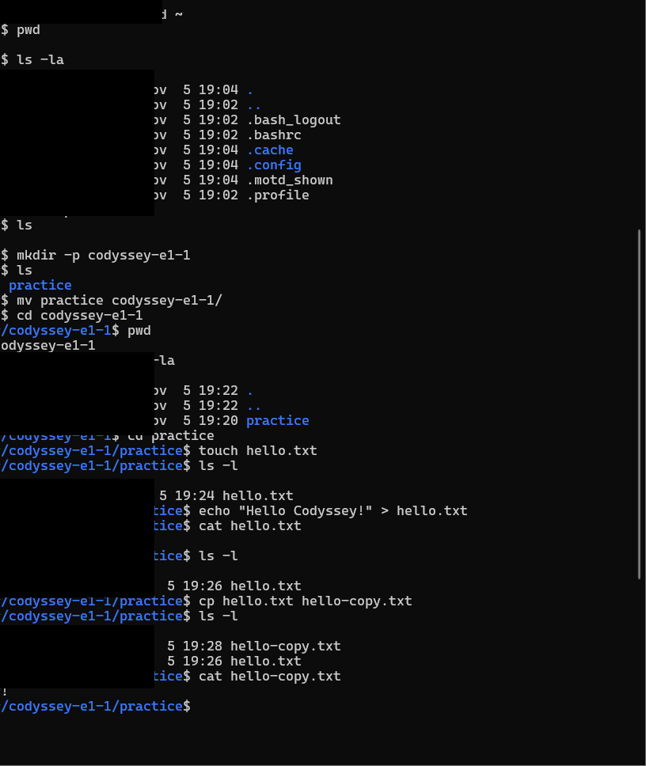
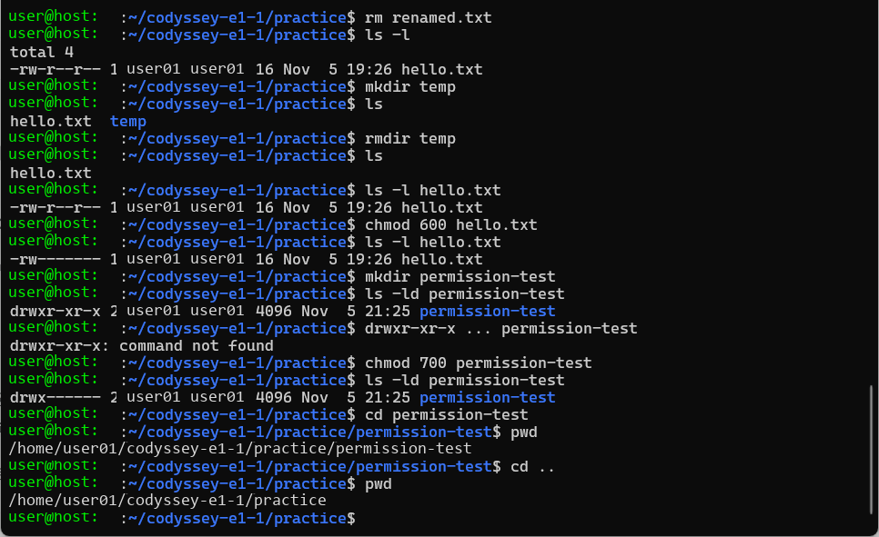
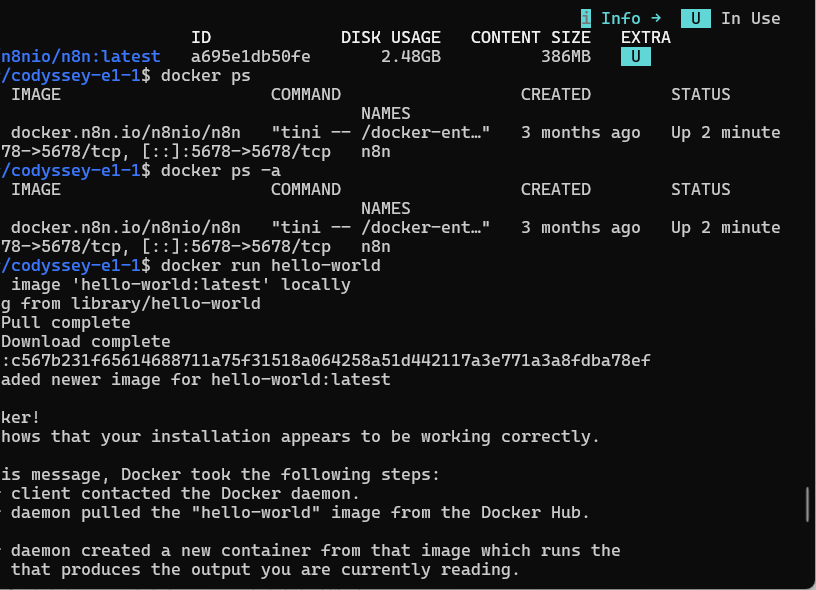
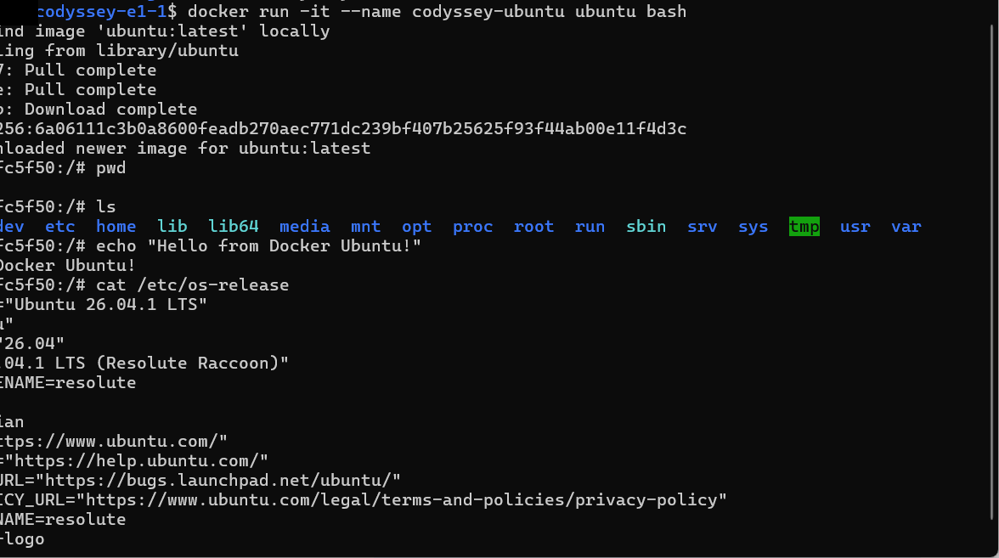
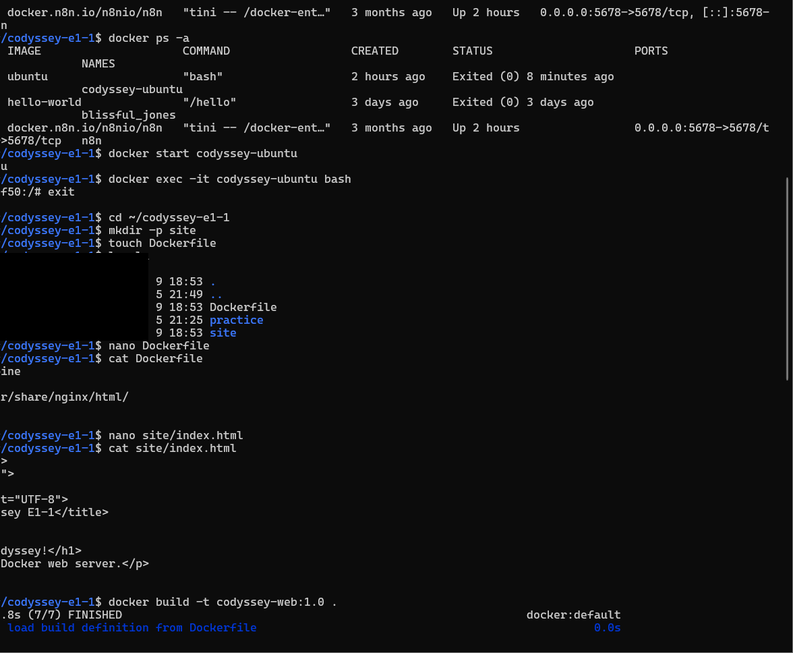
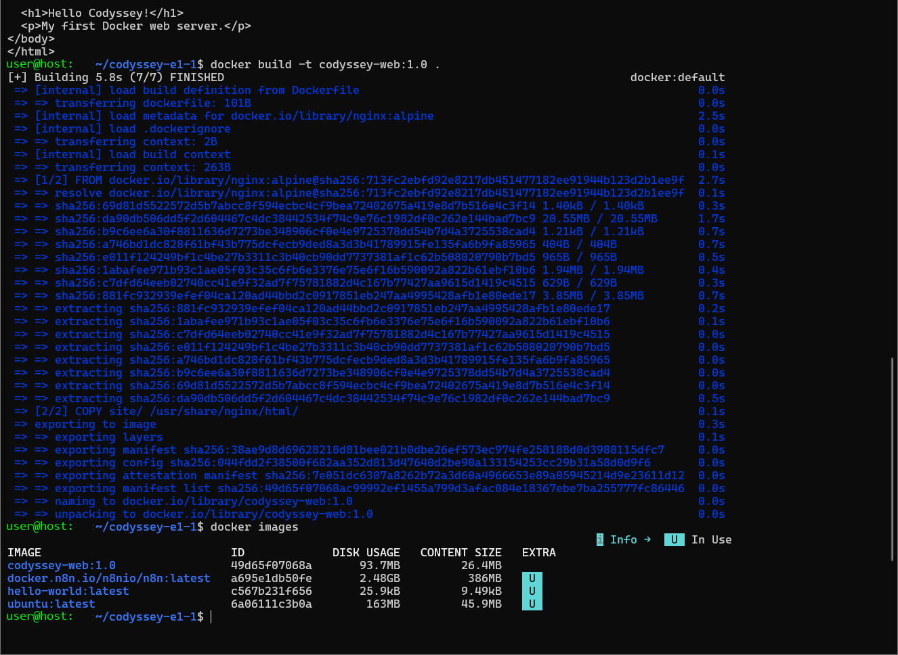
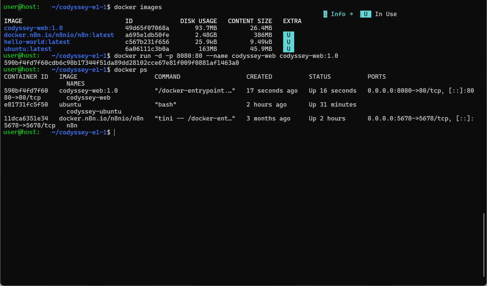
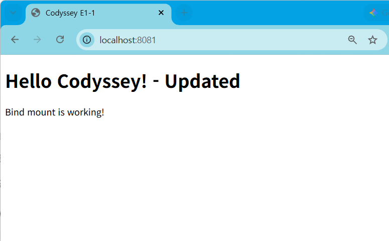

# Linux · WSL · Docker · Git 실습

> **Codyssey E1-1 · Development Environment & Container Fundamentals**  
> Windows에서 WSL Ubuntu 기반의 Linux 명령어를 익히고, Docker 컨테이너와 NGINX 이미지를 직접 실행·빌드하며, Git/GitHub로 결과물을 관리한 기초 인프라 실습입니다.

<p align="center">
  
  
  
  
  
  
</p>

---

## Summary

| 구분 | 내용 |
|---|---|
| 학습 목표 | Linux 파일 시스템과 권한, Docker 이미지·컨테이너, 포트 매핑과 마운트, Git 원격 저장소 흐름 이해 |
| 실행 환경 | Windows Terminal, WSL Ubuntu, Docker, Git/GitHub |
| 핵심 결과 | Linux 파일 작업, 권한 변경, Docker 실행 확인, Ubuntu 컨테이너 관리, NGINX 커스텀 이미지 빌드, 웹 서비스 실행, 바인드 마운트 반영 |
| 웹 이미지 | `nginx:alpine` 기반 `codyssey-web:1.0` |
| 포트 매핑 | 호스트 `8080` → 컨테이너 `80`; 바인드 마운트 결과는 `8081`에서 확인 |
| 저장소 | [GitHub Repository](https://github.com/qjskffj-code/codyssey_E1-1) |

### 바로가기

- [실습 목표](#실습-목표)
- [주요 실습 결과](#주요-실습-결과)
- [Linux 실습](#1-linux-cli와-권한)
- [Docker 실습](#2-docker-이미지와-컨테이너)
- [NGINX 웹 서버](#3-dockerfile과-nginx-웹-서버)
- [트러블슈팅](#troubleshooting)

---

# Overview

이 프로젝트는 개발 도구를 설치하는 데서 끝나지 않고, **호스트 운영체제 → WSL Linux → Docker Engine → 이미지 → 컨테이너 → 웹 브라우저**로 이어지는 실행 구조를 직접 확인하는 데 목적이 있습니다.

Linux에서는 디렉터리와 파일을 만들고 이동·복사·이름 변경·삭제했으며, `chmod`를 사용해 파일과 디렉터리 권한을 변경했습니다. Docker에서는 공식 `hello-world` 이미지로 엔진 동작을 확인한 뒤 Ubuntu 컨테이너의 생성·종료·재시작·접속 흐름을 실습했습니다.

마지막으로 `nginx:alpine`을 기반으로 정적 웹페이지를 포함한 커스텀 이미지를 빌드하고, 호스트 포트와 컨테이너 포트를 연결해 브라우저에서 결과를 확인했습니다. 바인드 마운트 실습에서는 호스트의 HTML 변경이 실행 중인 웹페이지에 반영되는 것도 확인했습니다.

## 실습 목표

1. Linux의 경로와 파일 시스템을 CLI로 다룬다.
2. 사용자·그룹·기타 사용자의 권한 표기를 이해하고 `chmod`로 변경한다.
3. Docker 이미지와 컨테이너의 차이를 실행 과정에서 확인한다.
4. 컨테이너 생성, 조회, 종료, 시작, 재접속의 생명주기를 익힌다.
5. Dockerfile로 재현 가능한 커스텀 이미지를 만든다.
6. 포트 매핑으로 컨테이너의 NGINX를 호스트 브라우저에 공개한다.
7. 바인드 마운트로 호스트 파일과 컨테이너 파일을 연결한다.
8. Git 커밋과 GitHub 원격 저장소 업로드 흐름을 경험한다.

## Tech / Tools

| 영역 | 사용 기술 | 역할 |
|---|---|---|
| Host | Windows, Windows Terminal | WSL과 Docker 실행 환경 |
| Linux | WSL Ubuntu | Linux CLI 및 파일 권한 실습 |
| Container | Docker | 이미지 빌드와 컨테이너 실행·관리 |
| Container OS | Ubuntu 26.04.1 LTS | 컨테이너 내부 Linux 환경 |
| Web Server | NGINX Alpine | 정적 웹페이지 제공 |
| Version Control | Git / GitHub | 변경 이력과 원격 저장소 관리 |

> Ubuntu와 Docker 버전은 실행 결과에서 직접 확인한 값만 명시했으며, 그 외 도구는 특정 버전에 의존하지 않도록 구성했습니다.

## Docker 버전과 데몬 검증

2026-11-11에 Windows PowerShell에서 Docker CLI와 Docker Desktop의 Linux 엔진 정보를 확인했습니다.

```powershell
docker --version
```

```text
Docker version 29.6.2, build dfc4efb
```

```powershell
docker version
docker info
```

```text
Client:
 Version:           29.6.2
 API version:       1.55
 OS/Arch:           windows/amd64
 Context:           desktop-linux

Server: Docker Desktop 4.85.0 (235549)
 Engine:
  Version:          29.6.2
  API version:      1.55 (minimum version 1.40)
  OS/Arch:          linux/amd64

docker info
Client:
 Version:           29.6.2
 Context:           desktop-linux
```

클라이언트와 서버 정보가 함께 출력되므로 Docker CLI가 `desktop-linux` 컨텍스트를 통해 Docker Desktop의 Linux 데몬에 연결된 상태임을 확인할 수 있습니다. 전체 출력은 [Docker 버전 및 데몬 실행 화면](#docker-버전과-데몬-상태)에서 확인할 수 있습니다.

---

# 주요 실습 결과

| ID | 실습 항목 | 결과 |
|---|---|---|
| E-01 | Linux 파일 작업 | 디렉터리 생성·이동, 파일 생성·출력·복사·이름 변경·삭제 |
| E-02 | Linux 권한 | `hello.txt`를 `600`, `permission-test`를 `700`으로 변경 |
| E-03 | Docker 엔진 | `hello-world:latest` 다운로드 및 `Hello from Docker!` 출력 |
| E-04 | Ubuntu 컨테이너 | `codyssey-ubuntu` 실행, 쉘 접속, Ubuntu 26.04.1 LTS 정보 확인 |
| E-05 | 컨테이너 생명주기 | 종료된 컨테이너를 `docker start`로 재시작하고 `docker exec`로 재접속 |
| E-06 | 커스텀 이미지 | `codyssey-web:1.0` 빌드 및 이미지 목록 등록 |
| E-07 | NGINX 포트 매핑 | `8080:80`으로 컨테이너 실행 |
| E-08 | 웹페이지 응답 | `localhost:8080`에서 정적 HTML 페이지 출력 |
| E-09 | 바인드 마운트 | HTML 수정 후 `localhost:8081` 페이지에 변경 내용 반영 |
| E-10 | GitHub | 프로젝트 파일을 원격 저장소에 업로드 |
| E-11 | Docker 환경 검증 | CLI 29.6.2, Docker Desktop 4.85.0, Linux 엔진 29.6.2 확인 |
| E-12 | 데이터 지속성 | 바인드 마운트 컨테이너 삭제·재생성 후 동일 파일 내용 확인 |

---

# 1. Linux CLI와 권한

## 파일과 디렉터리 작업

홈 디렉터리에서 실습 폴더를 구성하고 다음 명령의 동작을 확인했습니다.

```bash
pwd
ls -la
mkdir
cd
touch
echo
cat
cp
mv
rm
rmdir
```

실습 흐름은 다음과 같습니다.

```text
홈 디렉터리
└─ codyssey-e1-1/
   └─ practice/
      ├─ hello.txt
      └─ permission-test/
```

- `hello.txt`를 만들고 `Hello Codyssey!` 문자열을 저장했습니다.
- `cp`로 사본을 만든 뒤 `mv`로 이름을 변경했습니다.
- 불필요한 파일과 빈 디렉터리를 각각 `rm`, `rmdir`로 제거했습니다.

주요 실행 결과는 다음과 같습니다.

```text
$ cat hello.txt
Hello Codyssey!

$ cp hello.txt hello-copy.txt
$ ls -l
-rw-r--r-- 1 user01 user01 16 Nov 5 19:28 hello-copy.txt
-rw-r--r-- 1 user01 user01 16 Nov 5 19:26 hello.txt
```

## 권한 변경

`ls -l`로 권한을 확인한 뒤 숫자 표기법으로 권한을 변경했습니다.

```bash
chmod 600 hello.txt
chmod 700 permission-test
```

| 대상 | 권한 | 의미 |
|---|---|---|
| `hello.txt` | `-rw-------` | 소유자만 읽기·쓰기 가능 |
| `permission-test/` | `drwx------` | 소유자만 조회·생성·이동 가능 |

이 과정에서 파일 권한의 `r`, `w`, `x`가 각각 읽기, 쓰기, 실행/접근을 뜻하며, `600`과 `700`이 소유자에게만 권한을 부여한다는 점을 확인했습니다.

```text
$ chmod 600 hello.txt
$ ls -l hello.txt
-rw------- 1 user01 user01 16 Nov 5 19:26 hello.txt

$ chmod 700 permission-test
$ ls -ld permission-test
drwx------ 2 user01 user01 4096 Nov 5 21:25 permission-test
```

숫자 표기 한 자리는 각각 소유자·그룹·기타 사용자를 나타내며, `r=4`, `w=2`, `x=1`을 더해 권한을 구성합니다.

| 숫자 | 문자 표기 | 의미 | 대표 용도 |
|---:|---|---|---|
| `7` | `rwx` | 읽기·쓰기·실행 | 소유자 전용 디렉터리 |
| `6` | `rw-` | 읽기·쓰기 | 소유자 전용 일반 파일 |
| `5` | `r-x` | 읽기·실행 | 수정은 막고 실행·접근 허용 |
| `4` | `r--` | 읽기 전용 | 공개 읽기 파일 |
| `755` | `rwxr-xr-x` | 소유자는 전체 권한, 나머지는 읽기·실행 | 일반적인 공개 디렉터리 |
| `644` | `rw-r--r--` | 소유자는 수정, 나머지는 읽기 | 일반적인 문서 파일 |

---

# 2. Docker 이미지와 컨테이너

## Docker 실행 확인

공식 `hello-world` 이미지를 실행해 Docker 클라이언트가 데몬에 연결되고, 이미지 다운로드와 컨테이너 실행이 정상적으로 이어지는지 확인했습니다.

```bash
docker run hello-world
docker images
docker ps -a
```

확인 결과 `Hello from Docker!` 메시지가 출력되었고, 실행이 끝난 컨테이너는 `Exited (0)` 상태로 조회되었습니다. 이를 통해 **이미지는 실행에 필요한 불변 템플릿이고, 컨테이너는 그 이미지를 기반으로 생성된 실행 단위**라는 차이를 확인했습니다.

```text
Unable to find image 'hello-world:latest' locally
latest: Pulling from library/hello-world
Status: Downloaded newer image for hello-world:latest

Hello from Docker!
This message shows that your installation appears to be working correctly.
```

실습 화면에서 확인한 조회 결과의 핵심 상태는 다음과 같습니다.

```text
$ docker ps -a
codyssey-ubuntu   ubuntu        Exited (0)
hello-world       hello-world   Exited (0)

$ docker images
codyssey-web      1.0
hello-world       latest
ubuntu            latest
```

## Ubuntu 컨테이너

Ubuntu 컨테이너를 이름과 함께 대화형으로 실행했습니다.

```bash
docker run -it --name codyssey-ubuntu ubuntu bash
```

컨테이너 내부에서 기본 경로와 운영체제 정보를 확인했습니다.

```bash
pwd
ls
cat /etc/os-release
```

`/etc/os-release` 출력에서는 컨테이너가 **Ubuntu 26.04.1 LTS**임을 확인할 수 있습니다.

## 컨테이너 생명주기

종료된 컨테이너를 새로 만들지 않고 다시 시작한 뒤 쉘에 접속했습니다.

```bash
docker ps -a
docker start codyssey-ubuntu
docker exec -it codyssey-ubuntu bash
```

이 실습을 통해 `run`은 이미지에서 새 컨테이너를 만들고 실행하며, `start`는 기존 컨테이너를 다시 실행하고, `exec`는 실행 중인 컨테이너에서 추가 명령을 수행한다는 차이를 익혔습니다.

상태 변화는 **Dockerfile 작성 → 이미지 빌드 → 이미지에서 컨테이너 생성 → 실행 중 컨테이너의 쓰기 계층 변경 → 컨테이너 삭제 시 쓰기 계층 제거** 순서로 이해할 수 있습니다. 실행 중 변경을 다음 컨테이너에도 유지하려면 Dockerfile로 이미지를 다시 만들거나, 볼륨 또는 바인드 마운트에 데이터를 분리해야 합니다.

---

# 3. Dockerfile과 NGINX 웹 서버

## 프로젝트 파일

```text
codyssey-e1-1/
├─ Dockerfile
├─ practice/
└─ site/
   └─ index.html
```

| 경로 | 역할 | 분리한 이유 |
|---|---|---|
| `Dockerfile` | NGINX 이미지 생성 절차 | 실행 환경을 코드로 재현하기 위해 루트에 배치 |
| `practice/` | Linux 파일·권한 실습 결과 | 웹 애플리케이션 파일과 기초 CLI 실습을 분리 |
| `site/` | NGINX가 제공할 정적 콘텐츠 | 이미지 빌드와 바인드 마운트에서 동일한 소스를 재사용 |
| `assets/images/` | README 실행 증거 | 문서의 상대 경로로 GitHub에서 동일하게 표시 |

실습에 사용한 Dockerfile은 다음 구성입니다.

```dockerfile
FROM nginx:alpine

COPY site/ /usr/share/nginx/html/

EXPOSE 80
```

- `nginx:alpine`을 가벼운 베이스 이미지로 사용했습니다.
- 로컬 `site/`의 정적 파일을 NGINX 기본 문서 경로로 복사했습니다.
- 컨테이너가 80번 포트를 사용한다는 정보를 명시했습니다.

## 이미지 빌드

```bash
docker build -t codyssey-web:1.0 .
docker images
```

빌드 로그의 모든 단계가 완료되었고, `docker images`에서 `codyssey-web:1.0`이 생성된 것을 확인했습니다.

```text
[+] Building 5.8s (7/7) FINISHED
=> [internal] load build definition from Dockerfile
=> [2/2] COPY site/ /usr/share/nginx/html/
=> naming to docker.io/library/codyssey-web:1.0
```

## 포트 매핑과 웹페이지 확인

```bash
docker run -d -p 8080:80 --name codyssey-web codyssey-web:1.0
docker ps
```

포트 매핑 구조는 다음과 같습니다.

```text
Browser
  │  http://localhost:8080
  ▼
Windows Host :8080
  │  Docker port mapping
  ▼
NGINX Container :80
  │
  ▼
/usr/share/nginx/html/index.html
```

Docker는 컨테이너마다 독립된 **네트워크 네임스페이스**를 제공하므로, 컨테이너 내부의 `80`번 포트는 호스트의 `80`번 포트와 별개의 공간에 있습니다. `-p 8080:80`은 호스트의 `8080`으로 들어온 트래픽을 해당 컨테이너 네임스페이스의 `80`으로 전달하도록 Docker에 규칙을 만드는 옵션입니다. 이 매핑이 있어야 호스트 브라우저가 컨테이너의 NGINX에 접근할 수 있습니다.

브라우저에서 다음 내용이 출력되는 것을 확인했습니다.

```text
Hello Codyssey!
My first Docker web server.
```

실행 후 다음 명령으로 컨테이너 상태와 HTTP 응답을 추가 확인할 수 있습니다.

```bash
docker ps --filter name=codyssey-web
curl -i http://localhost:8080
```

정상 상태라면 `docker ps`의 `PORTS` 열에 `0.0.0.0:8080->80/tcp`가 표시되고, `curl`은 `HTTP/1.1 200 OK`와 HTML 본문을 반환합니다. 이 `curl` 출력은 재현 시 사용할 검증 기준이며, 현재 제출 증거는 브라우저 실행 화면입니다.

---

# 4. 바인드 마운트

이미지에 파일을 복사하는 방식은 HTML을 수정할 때마다 이미지를 다시 빌드해야 합니다. 개발 중에는 호스트의 `site/` 디렉터리를 컨테이너의 NGINX 문서 경로에 연결하는 바인드 마운트를 활용할 수 있습니다.

다음과 같이 호스트의 `site/` 디렉터리를 NGINX 문서 경로에 읽기 전용으로 연결할 수 있습니다.

```bash
docker run -d \
  -p 8081:80 \
  --name codyssey-bind \
  --mount type=bind,source="$(pwd)/site",target=/usr/share/nginx/html,readonly \
  nginx:alpine
```

`site/index.html`을 수정한 뒤 `localhost:8081`을 새로고침해 다음 변경 내용이 반영된 것을 확인했습니다.

```text
Hello Codyssey! - Updated
Bind mount is working!
```

이 결과를 통해 바인드 마운트는 **호스트 파일을 컨테이너에서 바로 참조**하므로, 정적 파일 수정 결과를 이미지 재빌드 없이 확인할 수 있다는 점을 이해했습니다.

## 경로 선택 기준과 재현성

- `source`는 실제 파일을 관리하는 **호스트의 절대 경로**여야 합니다. `$(pwd)/site`는 저장소 루트에서 명령을 실행한다는 전제가 있습니다.
- `target`은 NGINX가 문서를 읽는 **컨테이너 내부 경로**인 `/usr/share/nginx/html`로 지정했습니다.
- 다른 위치에서 명령을 실행하면 `$(pwd)`가 달라지므로 먼저 `pwd`와 `ls site`로 경로를 확인해야 합니다.
- 정적 파일 제공처럼 컨테이너가 호스트 파일을 수정할 필요가 없으면 `readonly`를 사용해 의도하지 않은 변경을 막습니다.

## 삭제·재생성 후 데이터 지속성 검증

바인드 마운트의 데이터가 컨테이너 쓰기 계층이 아닌 호스트에 저장되는지 확인하기 위해 전용 파일과 두 개의 컨테이너를 사용했습니다.

```powershell
$proof = Join-Path $PWD "persistence-proof"
New-Item -ItemType Directory -Force -Path $proof | Out-Null
Set-Content -LiteralPath (Join-Path $proof "evidence.txt") -Value "persistent data" -NoNewline

docker run --name persistence-before --mount "type=bind,source=$proof,target=/data,readonly" ubuntu cat /data/evidence.txt
docker rm persistence-before

docker run --name persistence-after --mount "type=bind,source=$proof,target=/data,readonly" ubuntu cat /data/evidence.txt
docker rm persistence-after
```

실제 실행 결과는 다음과 같습니다.

```text
=== 컨테이너 삭제 전 ===
persistent data

=== 첫 번째 컨테이너 삭제 ===
persistence-before

=== 새 컨테이너에서 다시 확인 ===
persistent data
persistence-after
```

첫 번째 컨테이너를 삭제한 뒤 동일한 호스트 디렉터리를 새 컨테이너에 마운트했을 때도 `persistent data`가 출력되었습니다. 따라서 파일이 삭제된 컨테이너 내부가 아니라 호스트의 `persistence-proof/`에 유지됐음을 확인했습니다.

<p align="center">
  
</p>

## 바인드 마운트와 볼륨, 백업 원칙

| 구분 | 바인드 마운트 | Docker 볼륨 |
|---|---|---|
| 저장 위치 | 사용자가 지정한 호스트 경로 | Docker가 관리하는 전용 영역 |
| 적합한 용도 | 소스 코드·설정 파일의 즉시 반영 | DB처럼 컨테이너와 분리할 운영 데이터 |
| 장점 | 호스트 도구로 바로 편집 가능 | 경로 의존성이 낮고 컨테이너 간 재사용이 쉬움 |
| 주의점 | OS별 경로와 권한 차이에 영향받음 | 직접 파일을 찾기보다 Docker 명령으로 관리 |

운영 데이터에는 이름 있는 볼륨을 사용하고 정기적으로 아카이브를 외부 저장소에 복사하는 방식을 권장합니다. 다음은 백업·복원 명령의 예시입니다.

```bash
# named volume 생성
docker volume create codyssey-data

# 백업: codyssey-data 내용을 현재 경로의 backup.tar.gz로 저장
docker run --rm \
  -v codyssey-data:/data:ro \
  -v "$(pwd)":/backup \
  alpine tar czf /backup/backup.tar.gz -C /data .

# 복원: 빈 볼륨에 백업 파일 풀기
docker volume create codyssey-data-restored
docker run --rm \
  -v codyssey-data-restored:/data \
  -v "$(pwd)":/backup:ro \
  alpine tar xzf /backup/backup.tar.gz -C /data
```

백업은 생성만으로 끝내지 않고 별도의 테스트 볼륨에 복원한 뒤 파일 목록과 애플리케이션 동작을 확인해야 합니다. 위 명령은 권장 절차이며 현재 실습 완료 증거로 간주하지 않습니다.

---

# Git / GitHub Workflow

로컬 프로젝트의 파일을 GitHub 원격 저장소에 업로드했습니다.

```bash
git init
git add .
git commit -m "Initial commit"
git remote add origin https://github.com/qjskffj-code/codyssey_E1-1.git
git push -u origin main
```

실제 업로드 성공 시 다음과 같이 `main -> main` 결과를 확인했습니다.

```text
To https://github.com/qjskffj-code/codyssey_E1-1.git
   main -> main
```

---

# Troubleshooting

## 1. Docker Desktop과 WSL 연동

| 항목 | 내용 |
|---|---|
| 증상 | WSL Ubuntu에서 Docker 명령이 정상적으로 연결되지 않음 |
| 원인 범위 | Docker Desktop의 WSL 연동 설정 또는 배포판 연결 상태 |
| 해결 방향 | Docker Desktop에서 WSL 기반 엔진과 Ubuntu 배포판 연동 상태를 점검하고 WSL 세션을 다시 시작 |
| 검증 | 이후 WSL에서 `docker run hello-world` 성공 |

## 2. Docker 소켓 접근 권한

| 항목 | 내용 |
|---|---|
| 증상 | 일반 사용자로 Docker 데몬 소켓에 접근하지 못함 |
| 원인 범위 | 현재 사용자의 Docker 그룹 권한이 세션에 반영되지 않음 |
| 해결 방향 | Docker 그룹과 사용자 권한을 점검한 뒤 WSL 세션을 다시 시작 |
| 검증 | 일반 사용자 프롬프트에서 `docker images`, `docker ps` 실행 성공 |

## 3. GitHub HTTPS 인증 실패

첫 `git push` 시 계정 비밀번호 방식으로 인증을 시도해 다음 오류가 발생했습니다.

```text
remote: Invalid username or token.
Password authentication is not supported for Git operations.
fatal: Authentication failed
```

GitHub HTTPS 인증에는 계정 비밀번호 대신 저장소 쓰기 권한이 있는 Personal Access Token을 사용했습니다. 인증 정보를 코드나 README에 저장하지 않고, 비밀번호 입력란에 토큰을 입력해 원격 업로드를 완료했습니다.

## 4. 호스트 포트 충돌

`docker run -p 8080:80 ...` 실행 시 `port is already allocated` 또는 `address already in use`가 발생하면 다음 순서로 확인합니다.

```powershell
# 1. 같은 포트를 게시한 Docker 컨테이너 확인
docker ps --filter publish=8080

# 2. Windows에서 포트를 점유한 프로세스 확인
Get-NetTCPConnection -LocalPort 8080 -ErrorAction SilentlyContinue |
  Select-Object LocalAddress, LocalPort, State, OwningProcess

# 3. PID의 프로세스 이름 확인
Get-Process -Id <OwningProcess>
```

점유 주체를 확인한 뒤 다음 중 하나를 선택합니다.

1. 불필요한 Docker 컨테이너라면 `docker stop <컨테이너명>`으로 정상 종료합니다.
2. 필요한 서비스라면 종료하지 않고 `-p 8081:80`처럼 사용하지 않는 호스트 포트로 변경합니다.
3. 임의로 프로세스를 강제 종료하기 전에 해당 PID가 어떤 서비스인지 반드시 확인합니다.

변경 후 `docker ps`와 `curl -i http://localhost:<포트>`로 매핑과 응답을 다시 검증합니다.

---

# 실행 화면

## Docker 버전과 데몬 상태

`docker --version`, `docker version`, `docker info`를 실행해 클라이언트 버전과 Docker Desktop Linux 엔진 정보를 확인했습니다.

<p align="center">
  
</p>

## Linux 파일 작업

디렉터리와 파일을 생성하고 내용을 작성한 뒤 복사 결과를 확인했습니다.

<p align="center">
  
</p>

## Linux 권한 변경

`chmod`를 이용해 파일과 디렉터리의 소유자 권한을 변경했습니다.

<p align="center">
  
</p>

## Docker 실행 확인

`hello-world` 컨테이너를 실행해 Docker 클라이언트와 데몬이 정상적으로 연결되는지 확인했습니다.

<p align="center">
  
</p>

## Ubuntu 컨테이너

Ubuntu 컨테이너에 접속해 기본 경로와 운영체제 정보를 확인했습니다.

<p align="center">
  
</p>

## 컨테이너 생명주기

종료된 컨테이너를 다시 시작하고 `docker exec`로 재접속했습니다.

<p align="center">
  
</p>

## 커스텀 이미지 빌드

Dockerfile을 이용해 `codyssey-web:1.0` 이미지를 빌드했습니다.

<p align="center">
  
</p>

## NGINX 포트 매핑

호스트의 8080번 포트와 컨테이너의 80번 포트를 연결해 웹 서버를 실행했습니다.

<p align="center">
  
</p>

## 바인드 마운트 반영

호스트의 HTML 변경 내용이 실행 중인 NGINX 페이지에 바로 반영되는 것을 확인했습니다.

<p align="center">
  
</p>

---

# What I Learned

- Linux에서 상대 경로와 절대 경로를 구분하고 파일 시스템을 CLI로 탐색하는 방법
- 파일과 디렉터리의 소유자 권한을 숫자 표기법으로 변경하는 방법
- Docker 이미지와 컨테이너가 각각 템플릿과 실행 단위라는 차이
- 컨테이너를 새로 생성하는 `run`과 기존 컨테이너를 재사용하는 `start`, `exec`의 역할
- Dockerfile의 명령을 이용해 동일한 실행 환경을 이미지로 재현하는 방법
- 호스트 포트와 컨테이너 포트를 연결해 외부에서 서비스에 접근하는 원리
- 이미지 빌드 시점에 파일을 복사하는 방식과 바인드 마운트로 실시간 연결하는 방식의 차이
- GitHub HTTPS 인증에서 계정 비밀번호 대신 PAT 등 지원되는 인증 수단이 필요하다는 점
- 실습 결과를 포트폴리오로 제시할 때 명령 자체보다 **재현 가능한 과정과 결과**가 중요하다는 점

## 한 줄 회고

> 개발 환경은 도구를 설치하는 것으로 완성되는 것이 아니라, **Linux 파일 권한부터 컨테이너 실행, 네트워크 연결, 데이터 연결, 버전 관리까지 각 계층이 어떻게 이어지는지 직접 검증할 때 비로소 이해할 수 있었습니다.**

